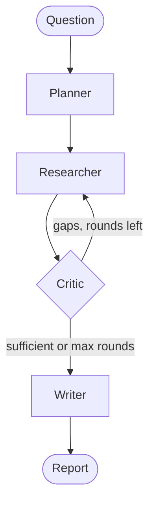

# Conclave

A multi-agent research assistant built with LangGraph. You give it a question; it plans subtasks, searches the web, checks its own coverage, and writes a report with sources.


## How it works

Four agents share a single state object:

- **Planner** splits the question into 3-4 subtasks
- **Researcher** runs a DuckDuckGo search per subtask and summarizes the results
- **Critic** checks whether every subtask is covered and lists any gaps
- **Writer** turns the findings into a markdown report with sources

If the critic finds gaps, the graph goes back to the researcher with those gaps as new subtasks. This repeats until the findings are sufficient or `MAX_CRITIQUE_ROUNDS` is reached.



## Getting started

```bash
git clone https://github.com/akruthigoud/conclave.git
cd conclave/backend
python -m venv .venv && source .venv/bin/activate
pip install -r requirements.txt

python cli.py "What is the current state of fusion energy research?"
```

By default it runs in `demo` mode, which needs no API key: the search is real, but summaries are built from the search snippets instead of an LLM. For proper summaries and critique, set an LLM provider in `backend/.env`:

```bash
LLM_PROVIDER=groq        # or openai
GROQ_API_KEY=your-key
```

There is also a REST API:

```bash
uvicorn app.main:app --reload
# POST /api/v1/research  {"question": "..."}
```

## Configuration

| Variable | Default | Description |
|---|---|---|
| `LLM_PROVIDER` | `demo` | `demo`, `openai`, or `groq` |
| `MAX_SUBTASKS` | `4` | Subtasks created by the planner |
| `MAX_CRITIQUE_ROUNDS` | `2` | Max research/critique loops |
| `MAX_SEARCH_RESULTS_PER_SUBTASK` | `4` | Search results per subtask |

## Tests

```bash
cd backend
pytest -v
```

20 tests covering each agent and the full graph. Search and LLM calls are mocked, so the tests run offline. `test_graph.py` includes a check that the critique loop always stops at the round limit.

## Project structure

```
backend/
├── app/
│   ├── agents/      # planner, researcher, critic, writer
│   ├── core/        # config, LangGraph workflow
│   ├── services/    # LLM providers, web search
│   ├── models/      # graph state, API schemas
│   └── api/         # FastAPI routes
├── cli.py
└── tests/
```

## Limitations

- Demo mode summaries are stitched search snippets, not written prose
- Duplicate sources across subtasks are not merged
- Search results are not cached between runs

## License

MIT
