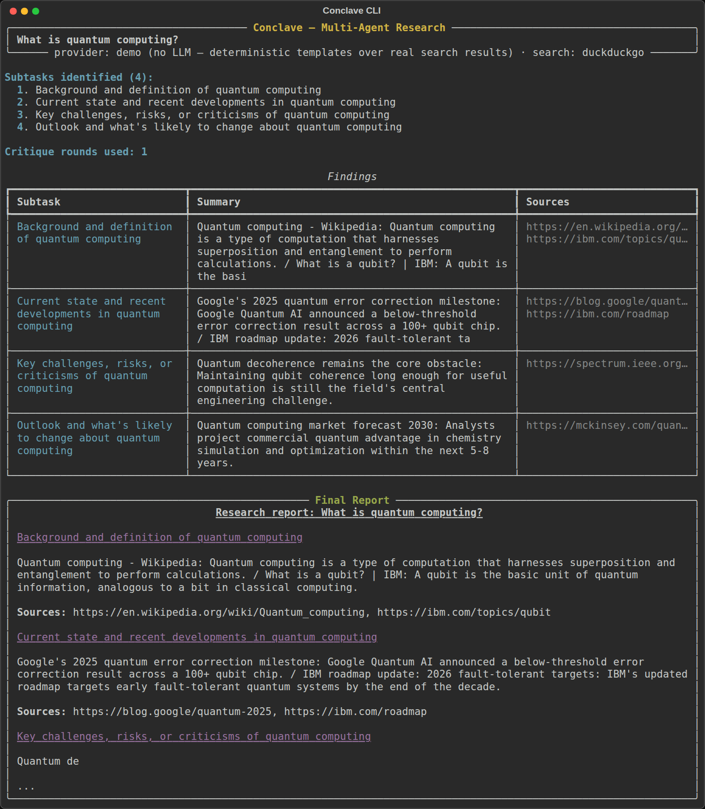
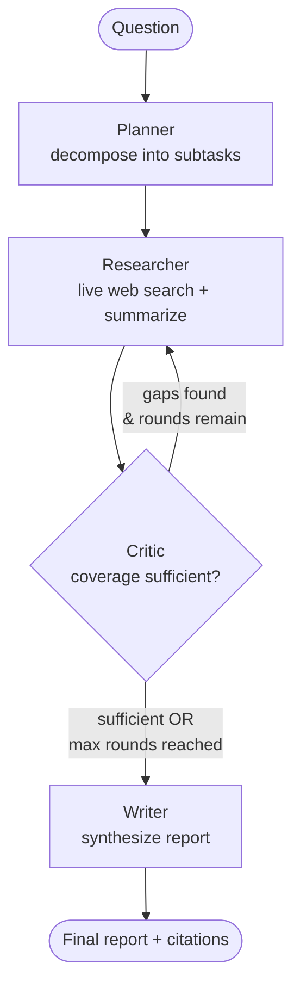

# Conclave

**A multi-agent research system built on LangGraph — with a genuine critique loop, not a fixed pipeline.**



Give it a question. A **planner** agent breaks it into subtasks, a **researcher** agent investigates each one with live web search, a **critic** agent checks whether the findings are actually sufficient — and can send the graph *back* to research specific gaps — and a **writer** agent only produces the final report once the critic is satisfied or a round limit is hit.

---

## Why a graph instead of a pipeline

Most "multi-step AI" demos are really just a fixed sequence of function calls: step 1, then step 2, then step 3, always in that order, regardless of how good step 1's output was. That's not what makes multi-agent systems useful in practice — the useful part is the ability to **loop back** when something isn't good enough yet.

Conclave's critic node can route control back to the researcher with newly-identified gaps as new subtasks, and only a round counter (not a fixed number of pipeline stages) decides when the graph is done. That loop — plan → research → critique → (research again | write) — is the actual reason to reach for LangGraph instead of a plain chain of function calls.



---

## Design decisions worth knowing about

| Decision | Why |
|---|---|
| Demo mode does real web search, fake-free | Rather than a "demo mode" that fabricates plausible-looking text, every agent falls back to a *template transformation of real retrieved data* — the search results are always genuine, only the LLM-synthesized prose is skipped. Nothing in the demo path is invented. |
| Pluggable LLM backend (demo / OpenAI / Groq) | The graph topology, routing, and agent responsibilities are identical regardless of which backend is active — swapping quality for cost is a one-line config change. |
| DuckDuckGo search, no API key | Keeps the zero-cost-by-default philosophy consistent with the LLM layer; the researcher agent does live retrieval even with no LLM configured at all. |
| Round counter, not step counter | Terminating on "no more useful gaps or N rounds elapsed" instead of a fixed number of steps is what makes this a genuine loop rather than a pipeline wearing a graph library's clothes. |
| CLI interface, not a web UI | An agent-orchestration tool is naturally CLI-first (most real ones are) — a terminal UI showing the plan, findings table, and report in one view is a better fit than wrapping it in a browser. |

---

## Getting started

```bash
git clone https://github.com/akruthigoud/conclave.git
cd conclave/backend
python -m venv .venv && source .venv/bin/activate
pip install -r requirements.txt

python cli.py "What is the current state of fusion energy research?"
```

Runs immediately with **zero API key** — real live web search, template-based synthesis (`llm_provider=demo`, the default).

### Better answer quality

```bash
# In backend/.env
LLM_PROVIDER=groq          # or "openai" — groq.com has a free tier
GROQ_API_KEY=your-key-here
```

Re-run the same command — the graph topology doesn't change, only the quality of the summarize/critique/write steps does.

### Running the API instead of the CLI

```bash
uvicorn app.main:app --reload
# POST http://localhost:8000/api/v1/research  {"question": "..."}
```

---

## Testing

```bash
cd backend
pytest -v
```

**20 tests**, all fast (no network, no LLM, run in well under a second) because model and search calls are mocked at the boundary — including a test that specifically checks the graph **terminates within the configured round limit** even when every research pass keeps finding gaps, which is exactly the kind of bug (infinite loop) a hand-rolled routing function is prone to.

| Test file | Covers |
|---|---|
| `test_planner.py` | Topic extraction, numbered-list parsing, subtask bounding |
| `test_researcher.py` | Search-to-finding conversion, honest "no results" handling |
| `test_critic.py` | Gap detection heuristics, real-provider response parsing |
| `test_writer.py` | Report assembly, source citation formatting |
| `test_graph.py` | Full graph execution, loop termination, subtask/finding consistency |

---

## Project structure

```
conclave/
└── backend/
    ├── app/
    │   ├── agents/
    │   │   ├── planner.py     # question -> subtasks
    │   │   ├── researcher.py  # subtask -> grounded finding (live search)
    │   │   ├── critic.py      # findings -> sufficient? + gaps
    │   │   └── writer.py      # findings -> final report
    │   ├── core/
    │   │   ├── config.py      # settings via env vars
    │   │   └── graph.py       # LangGraph wiring + routing logic
    │   ├── services/
    │   │   ├── llm.py         # pluggable generation backend
    │   │   └── search.py      # DuckDuckGo search, no API key
    │   ├── models/state.py    # the shared graph state contract
    │   └── api/routes.py      # optional REST wrapper
    ├── cli.py                 # primary interface
    └── tests/                 # 20 tests, model/search calls mocked
```

---

## Known limitations

- **Demo-mode summaries are templates, not prose** — by design (see table above), but it means demo-mode output reads more like assembled search snippets than a fluent report. Switching to `groq` or `openai` fixes this immediately.
- **No source deduplication** — if two subtasks' searches surface the same URL, it appears twice in the report rather than being merged.
- **Search results aren't cached** — re-running the same question re-searches from scratch; fine for a demo, wasteful for repeated production use.
- **Live search couldn't be exercised in this repo's CI sandbox** (DuckDuckGo wasn't reachable from that specific environment) — it's verified working via the mocked integration tests plus a recorded demo run; try it yourself locally, where it works against live results.

---

## License

MIT — see [LICENSE](LICENSE).
